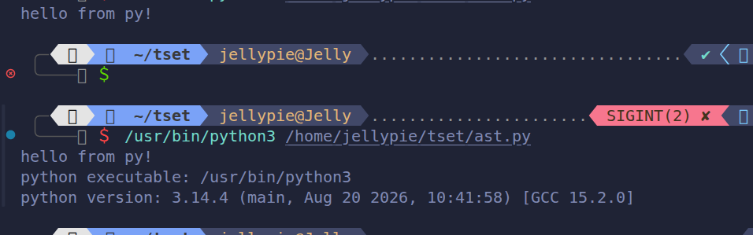
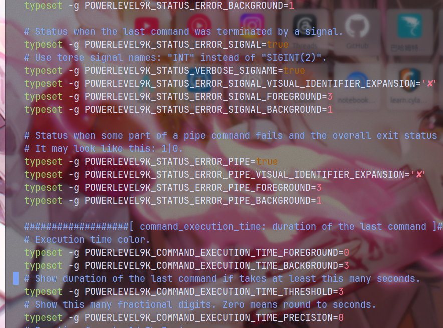
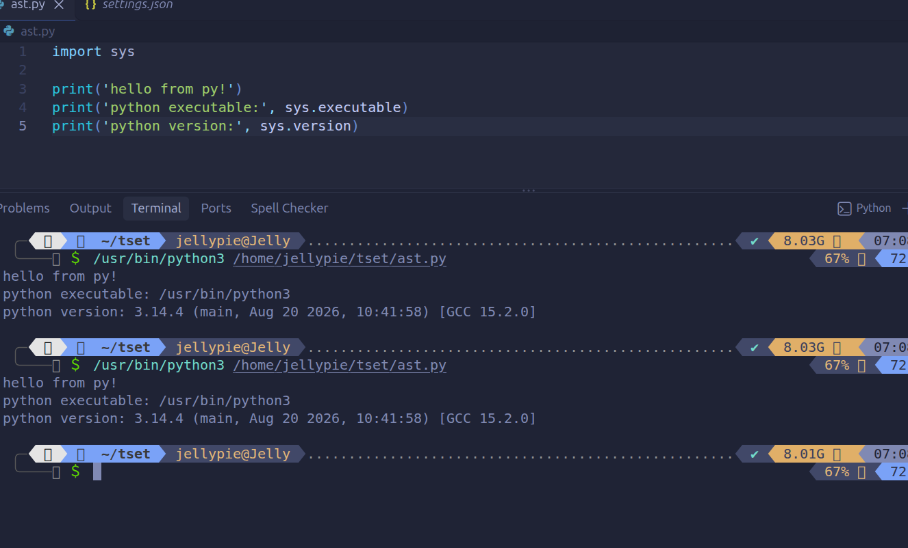

## 故障排除流程
我試了一些比較有可能會造成這問題的方法
### 直接終端機輸入   
試過直接手動執行，輸入`python3 -c 'print('test')'`是正常的，完全沒有錯誤出現。
### Vscode Extension
逐一關閉擴充插件測試，問題還在。
### 關閉 Python Environment
關掉 Python Environment ＆ terminal.env 也沒效。
### 用 Python sys module 測試
試試看 Import `sys` 模組：
```python
import sys

print('hello from py!')
print('python executable:', sys.executable)
print('python version:', sys.version)
```
輸出：

看起來還是一樣沒變。
### 查看 '~/.p10k.zsh` 的設定
用 `vim` 或 `nano` 查看 `~./.p10k.zsh` 的設置。去 p10k `status: exit code of the last command`的 section 可以找到：

ㄜ，看起來也沒什麼太大的問題。
### 關掉終端機 shell 整合
之後我跑去 `User setting (JSON)`把終端機整合關掉。   
`"terminal.integrated.shellIntergration.enabled": false,`
變正常了：

## 總結
試了很多遍我在想有可能是因為 VS Code 終端機整合跟 Zsh 環境不相容或是有衝突才造成這個奇怪的錯誤訊息。     
最後：
- Python 3.14.4 正常
- `/usr/bin/python3`是正確的路徑
- 關掉 Python Env 沒用
- 關掉終端機整合就成功了
## 結語
我查了一下網路但還是找不到跟我有一樣問題的輸出，或許有，但大部分都是圍繞在關閉 Python Env 上。不過目前問題是解決了，如果後續有找出更好的方案，我會更新這篇文章，然後內文有誤的話請 DM 我，謝謝！ :D 
