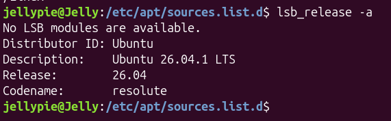
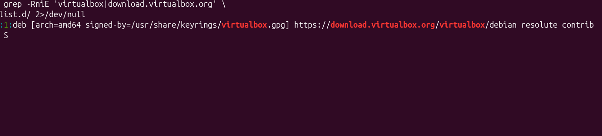
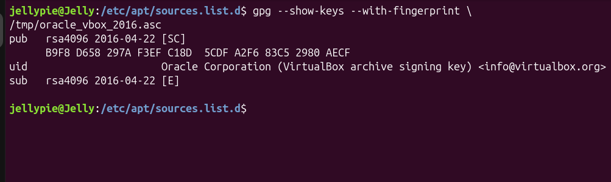
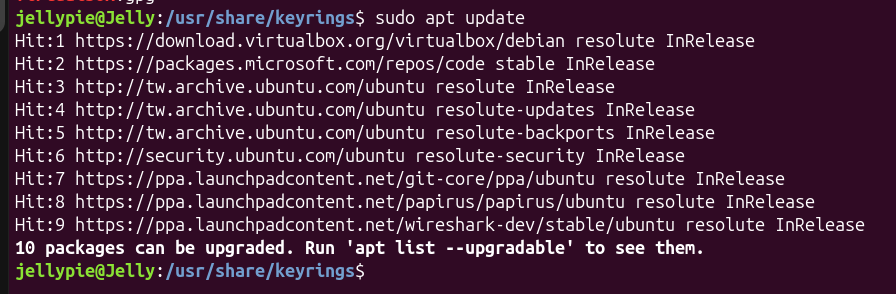

# 主旨
:::note
參考 VirtualBox 官方網站下載指南：[Download VirtualBox for Linux Hosts](https://www.virtualbox.org/wiki/Linux_Downloads)
:::
修復下載 VirtualBox 時出現 NO_PUBKEY 的錯誤   
我的版本：   

## 問題描述 | Problem
我在終端機使用`sudo apt update`時出現以下錯誤：   
```bash
Warning: OpenPGP signature verification failed:
https://download.virtualbox.org/virtualbox/debian resolute InRelease:

The following signatures couldn\'t be verified because
the public key is not available:

NO_PUBKEY A2F683C52980AECF

Error: The repository is not signed.
```
從錯誤訊息中可知 Ubuntu 找不到相應的 GPG 公鑰，所以就沒辦法驗證 Virtualbox repo 的簽證。   
為了避免下載到來源不明的套件(或是檔案內容被竄改)，APT 會比對官方給的 GPG 金鑰。
## 流程 | Process
### VirtualBox Repo 的設定
先找到 Virtualbox repo 的設定：
   
我的是：
```bash
deb [arch=amd64 signed-by=/usr/share/keyrings/virtualbox.gpg] https://download.virtualbox.org/virtualbox/debian resolute contrib
```   
其中 `signed-by=/usr/share/keyrings/virtualbox.gpg` 就是公鑰指定的位置。
### 下載官方 GPG 公鑰
~~我把`/etc/apt/keyrings/`跟`/usr/share/keyrings/`搞錯了~~
好（咳，這不是重點，現在要來下載官方給的公鑰：   
```bash
wget -O /tmp/oracle_vbox_2016.asc \
https://www.virtualbox.org/download/oracle_vbox_2016.asc
```   
:::note
注意檔案是.asc，也就是 ASCII 檔。   
`/tmp/`我放在 tmp 目錄
`wget -O`指定下載檔案名稱及位置。    
`\`就單純想換行（可不用） :P
:::   
然後在驗證看看剛剛下載的`oracle_vbox_2016.asc`是不是正確的：   
```bash
gpg --show-keys --with-fingerprint /tmp/oracle_vbox_2016.asc
```  
### 驗證指紋 
確認 Fingerprint 金鑰指紋是否跟官方的吻合：   

```text
B9F8 D658 297A F3EF C18D  5CDF A2F6 83C5 2980 AECF
```   
跟官方的指紋一致
### 加入金鑰
接下來.asc轉成.gpg，並輸出至指定位置
```bash
sudo gpg --dearmor --yes -o /usr/share/keyrings/virtualbox.gpg /tmp/oracle_vbox_2016.asc
```   
`gpg --dearmor`	把 ASCII armor 解包並轉換回二進位格式  
`-yes` 覆蓋既有輸出檔案時自動確認   
`-o` 指定輸出檔案   
在確認是否有成功建立：   
```bash
ls /usr/share/keyrings | grep 'virtualbox'
```   
Output:   

## 結果 | Results
再 run 一次 `sudo apt update`：   
   
成功ㄌ～這次就沒有出現 `NO_PUBKEY A2F683C52980AECF`等訊息了。   

